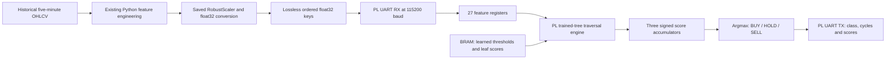

# ZCU104 trained LightGBM deployment

The final decision comes from the saved `lgbm.pkl` trained model. The old EMA/ATR/crossover design remains in its original directory and is outside this ML hardware design.

Hardware target: `xczu7ev-ffvc1156-2-e`, 125 MHz differential clock F23/E23, UART RX A20 and TX C19. Inference executes entirely in PL. Host feature engineering and scaling are explicit preprocessing stages. No PS processor, DDR, AXI bus, or DPU is needed for this 32 KB learned-tree ROM architecture.

The model takes a single bar of 27 features. LSTM and CNN take 30 × 27 sequences; their saved ONNX graphs are audited in `reports/model_audit.json`. This design deploys the existing LightGBM, without retraining or substituting rule logic.

## Numerical representation

Finite float32 features are represented losslessly as monotonically ordered signed integer keys. Positive values use their IEEE bits; negative values use the complement of the magnitude bits. Zero is canonicalized. Learned double thresholds are lowered to the largest float32 value no greater than that threshold before encoding. The signed integer comparison therefore reproduces the original `feature <= threshold` decision for finite float32 inputs. NaN and infinity are rejected by host preprocessing.

Leaf scores use signed 32-bit integers with 24 fractional bits; accumulated class scores use signed 64-bit integers. There is no feature quantization error relative to the model's float32 inputs. Argmax is equivalent to argmax after softmax, so hardware does not need exponentiation or division. Ties favor the lowest class index, as NumPy does.

## UART protocol

Request: `A5`, then 27 little-endian signed 32-bit encoded feature keys (109 bytes total). Response: `5A`, class byte (`0=BUY`, `1=HOLD`, `2=SELL`), unsigned little-endian 32-bit core cycle count, then three little-endian signed 64-bit fixed-point scores (30 bytes total). Divide scores by 2^24 to recover raw class scores. This mapping differs from the old baseline UART protocol.

The host must use stop-and-wait: send one complete request and await one complete reply before sending the next. There is one inference buffer and no input queue. Bytes arriving during compute/transmission are discarded. There is no packet checksum or timeout recovery; reset/reprogram and flush the port after a broken/truncated packet. This is a deterministic laboratory protocol, and sustained-rate claims must respect its framing.

## Reproducibility and artifacts

- `export_model.py`: read saved model/scaler, audit ONNX, export actual learned ROMs, create held-out vectors and validate the representation.
- `preprocessing.py`: finite-input validation and lossless key encoding.
- `check_historical.py`: regenerate historical features and verify cached features/labels, measuring batch host preprocessing.
- `rtl/ml_core.v`: synchronous BRAM tree traversal and score accumulation.
- `rtl/fpga_ml_top.v`: reused differential clock/UART and packet logic.
- `rtl/tb_ml_core.v`, `rtl/tb_uart.v`, `rtl/tb_workloads.v`: full held-out, serial, and workload simulations.
- `simulate.ps1`: reproducible Vivado simulator invocation.
- `build.tcl`: actual Vivado synthesis, implementation, bitstream, timing, utilization, power, and DRC reports.
- `hardware.tcl`: program the generated ML bitstream through Vivado Hardware Manager.
- `host_test.py`: actual COM7 test, exact score verification, hardware cycle and host timing capture.
- `cpu_reference.py`: separately labeled actual local PC model benchmark.
- `evaluate.py`: consolidate simulation evidence without inventing hardware values.
- `rtl/uart_power.tcl`, `power_activity.tcl`: UART simulation switching activity and routed power estimation.

The consolidated report records which stages actually completed. A generated script alone is not evidence of a successful run. CSVs contain every validation prediction/cycle/score and workload timing, and JSON files preserve numeric provenance.

## Completed hardware result

The generated bitstream was actually programmed onto the ZCU104 through Vivado. All 643 unique held-out inputs returned the original trained model's predictions and exact integer class scores over COM7. Three complete validation runs, three physical workload levels, and a BUY/HOLD/SELL jury demo were recorded. See `FINAL_REPORT.md` for measured cycle latency, complete host/FPGA latency, actual sustained rate, routed resources, estimated power, and remaining measurement limits. `demo.py` provides the short repeatable board demonstration.
